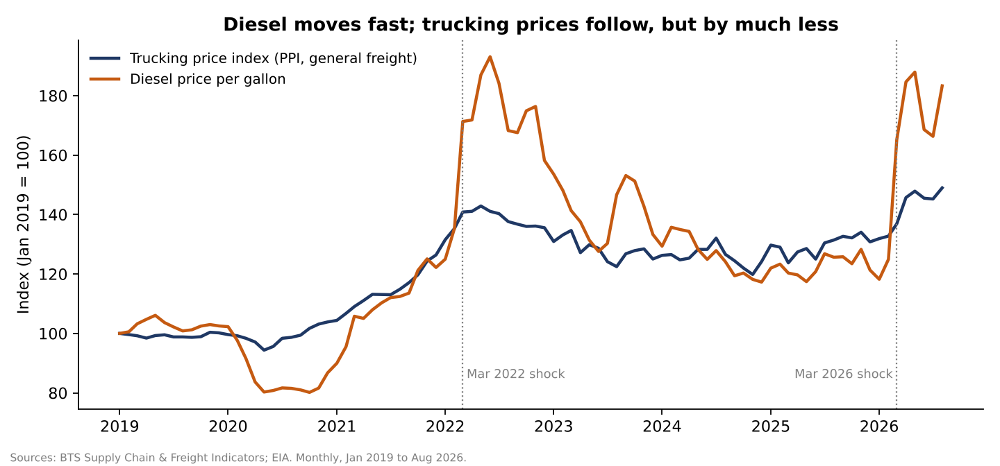
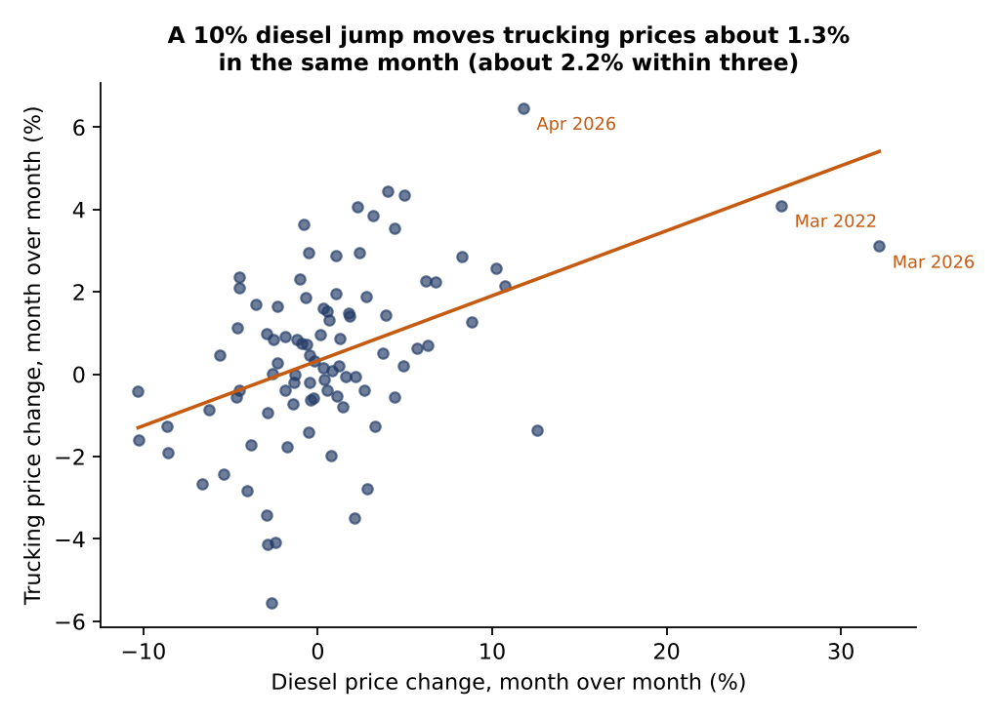
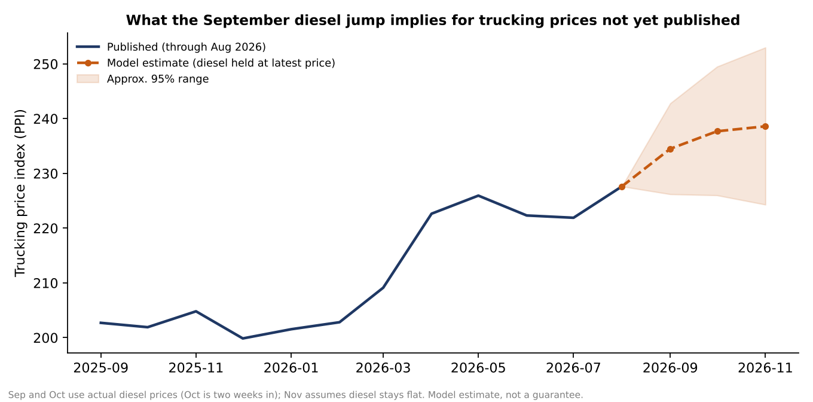
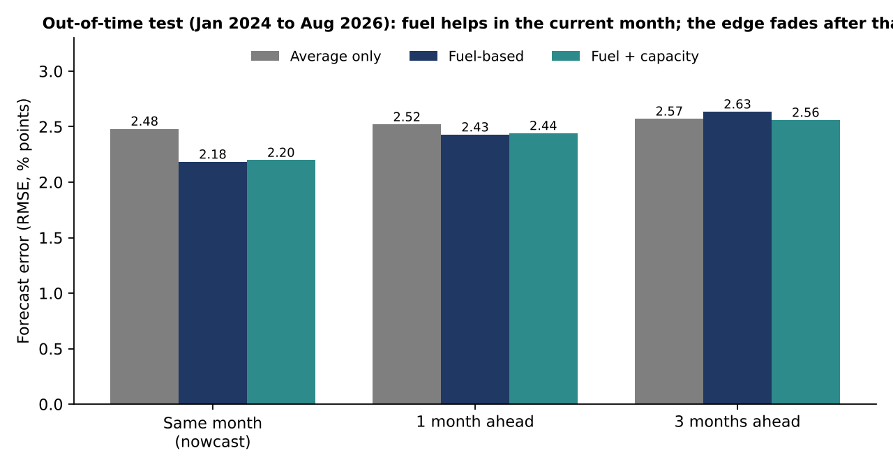
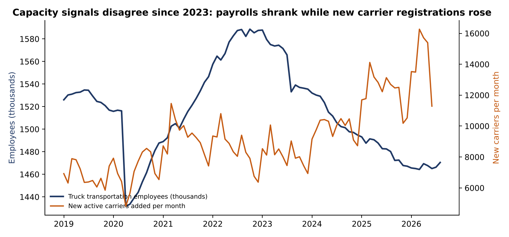

# OTR Trucking: What Fuel Prices Tell a Planner About Trucking Costs

A monthly analysis of U.S. trucking prices, diesel, freight demand and capacity indicators, built on public data, Jan 2019 to Aug 2026. It asks a question an over-the-road (OTR) planning team faces every time diesel moves: **how much of a fuel move shows up in trucking prices, how fast, and can the other capacity signals add anything?**

**Tools:** SQL (SQLite), Python (pandas, statsmodels, matplotlib), Tableau-ready extracts. All data is real and public. Nothing is simulated.

## Short answer

| Question | Finding |
|---|---|
| How much of a diesel move reaches trucking prices? | About **0.22%** per 1% diesel change within three months (95% CI 0.16 to 0.28). Roughly 0.13 lands the same month and 0.07 the next. |
| How much of monthly price movement is fuel? | Little. Fuel explains **27%** of month-to-month variation in the trucking price index. |
| Does it work as a planning tool? | For the **current month**, yes: 12% lower error than a no-fuel baseline on data the model never saw (Jan 2024 to Aug 2026). One month ahead the edge is marginal (4% on RMSE, none on MAE). At three months it is worse than the baseline. |
| Do capacity indicators (truck payrolls, new carriers, freight per trucker) improve it? | **No.** They add nothing in sample (F-test p = 0.32) or out of time. |
| Can this index stand in for spot-market rates? | **No.** It correlates only 0.22 with DAT dry-van spot rates (65 months to May 2024). |
| Is the pass-through stable? | Direction is stable in every sub-period, but size is not. After the two biggest diesel jumps, the model overshot by 1.6 points once and undershot by 2.5 points the other time. Plan with a band. |





## Why the obvious chart is misleading

Year-over-year trucking prices and year-over-year diesel correlate at **0.91**. That number looks decisive and is mostly an artifact: both series trend and overlap in time (ADF test p = 0.50 and 0.30, so neither is stationary). The analysis therefore works on month-over-month changes, which pass the stationarity test (p < 0.01), and the headline relationship drops from "explains 82%" to "explains 27%". The second number is the honest one.

## Current planning read (as of Oct 18, 2026)

Weekly diesel averaged **$6.29 in September, 15.2% above August**. The trucking price index is published only through August (227.6). Using the pass-through model:

| Month | Diesel basis | Estimated index | Approx. 95% range |
|---|---|---|---|
| Sep 2026 | actual weekly prices | 234.5 | 226 to 243 |
| Oct 2026 | actual prices, two weeks in | 237.7 | 226 to 250 |
| Nov 2026 | assumes diesel stays at $6.18 | 238.6 | 224 to 253 |

That is about **+4.8% versus August** by November. Treat September as the most reliable number. The out-of-time test supports the model for the current month only, and November rests on an assumption.



## Method

1. **Question and scope.** Defined the decision first: a planner needs to know how fuel moves reach prices and whether other signals help.
2. **Acquire.** Pulled 3,467 rows from the BTS Supply Chain and Freight Indicators dataset (data.bts.gov, `y5ut-ibwt`) and 406 weekly diesel prices from the EIA API. Raw files are saved untouched in `data/raw/` with sources in `SOURCES.md`.
3. **Profile and clean in SQL.** Checked coverage, nulls, duplicates, units and hidden characters before changing anything (`sql/01_profile.sql`). Cleaning is a separate layer (`sql/02_clean.sql`) and the raw tables are never edited.
4. **Validate.** 13 automated checks (`sql/03_validate.sql`), including an independent reconciliation of the BTS diesel series against EIA: 405 weeks compared, maximum difference $0.000.
5. **Model features.** Year-over-year and month-over-month changes by SQL window functions (`sql/04_features.sql`).
6. **Analyze.** Distributed-lag regression with HAC standard errors, sub-period stability, expanding-window out-of-time tests at three horizons against a baseline, a nested F-test for capacity variables, spot-rate validation and an event check on the two largest diesel jumps (`src/03_analysis.py`).
7. **Communicate.** Five charts and five flat extracts for Tableau (`outputs/`).

## Findings in detail

- **Pass-through** (`n = 89` months): same-month coefficient 0.131 (p < 0.001), one-month lag 0.074 (p = 0.09), two-month lag 0.014 (p = 0.53). R² 0.27.
- **Out-of-time test** (32 months, model refit every month): nowcast RMSE 2.18 vs 2.48 baseline; one month ahead 2.43 vs 2.52; three months ahead 2.63 vs 2.57.


- **Shock events.** March 2022: diesel +26.6% in a month, trucking prices +4.3% (model predicted 5.8%). March 2026: diesel +32.2%, trucking prices +9.6% by the third month (model predicted 7.1%). Two events are too few to explain the difference, and this project does not try to.
- **Capacity signals disagree.** Truck transportation payrolls fell from 1,588.6k (Oct 2022) to 1,470.5k (Aug 2026), down 7.4%, while new active carriers added per month rose from an average of 8,181 in 2023 to 12,276 in 2025. This is described, not explained. The data cannot say why.



## What a planner would do with this

- Treat a weekly diesel jump above 10% as a same-month price signal worth about 1.3% in trucking prices, and budget a band of roughly plus or minus 2 points around the three-month figure.
- Do not use diesel to forecast trucking prices three months out. The test says it does not work.
- Do not expect payroll or carrier-entry data to improve a monthly price estimate. Use them as context for capacity conversations.
- Do not read the index as spot-market pricing.

## Limitations

- National, monthly aggregates. No lane, region or carrier detail. Lane-level cost planning needs data this project does not have.
- The index is a producer price series. I did not verify how fuel surcharges are treated in it, so I make no claim about that.
- 89 months and two shock events. Estimates are directional, not precise.
- The planning table fits one linear model on the full sample and holds diesel flat in November. It is an estimate, not a forecast with a guarantee.
- Freight Services Index and inventory-to-sales are unpublished for the latest month, and new carrier counts end in June 2026. Models drop months with missing inputs.
- BTS and EIA revise figures. Rerunning later may move the numbers slightly.

## Reproduce

```
pip install -r requirements.txt
bash run_all.sh
```
`run_all.sh` rebuilds everything from the files in `data/raw/`. `src/00_fetch_data.py` re-downloads those files from the BTS and EIA APIs (the EIA step needs a free API key in `EIA_API_KEY`). That fetch script was written after the raw files were pulled through a different route and has not been run end to end, so check its output against `SOURCES.md` before relying on it.

## Repository map

```
data/raw/         API responses exactly as received
data/processed/   SQLite database, results.json, feature file
sql/              profile, clean, validate, features
src/              ingest, SQL runner, analysis, charts and extracts
outputs/          five charts and five Tableau-ready CSVs
docs/             data quality log, data dictionary, dashboard build spec
```
